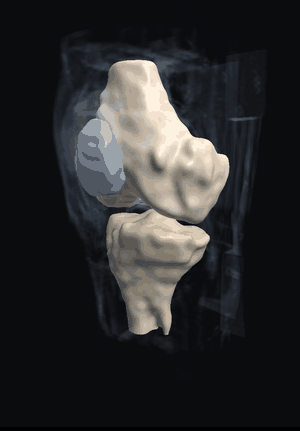
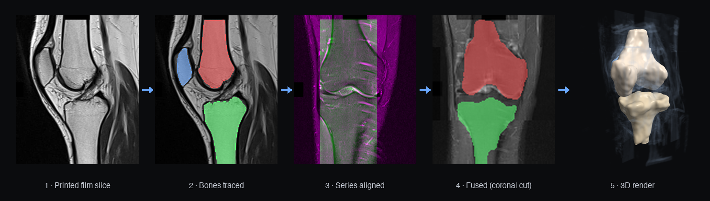
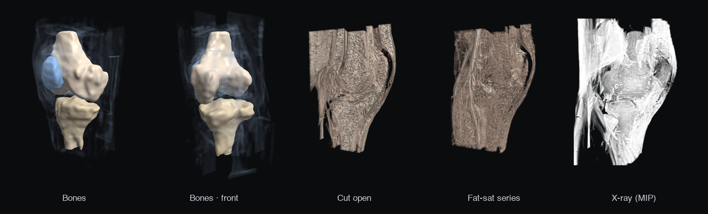
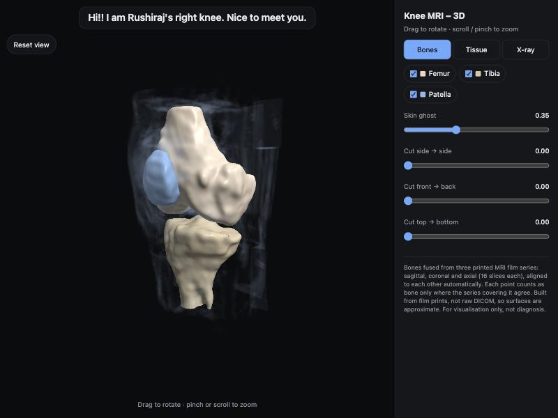
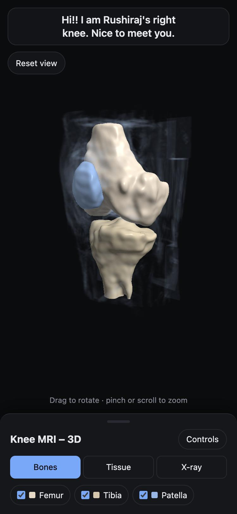

# 🦵 knee-mri-3d

**I got a knee MRI. The clinic gave me a 3-page PDF of printed film. I turned it into an interactive 3D model of my knee.**

<p align="center">
  
</p>

<p align="center">
  <b><a href="https://knee-3d.vercel.app/">▶ Live demo</a></b> · works on phone and laptop · no install
</p>

---

## The problem

A real 3D reconstruction normally starts from **DICOM**, the raw scanner files with exact slice positions and pixel spacing.
All I had was a **PDF of film prints**: 81 grey film images on 3 pages, with no coordinates and no metadata, and the scale differed between series.

So the pipeline had to work out the geometry from the images themselves.

## How it works

<p align="center"></p>

1. **Cut the film apart.** Each PDF page is one big image. I slice it into a 6×6 grid of tiles and get three stacks of 16 slices each: **sagittal** (side view), **coronal** (front view) and **axial** (top-down). Edge tiles carrying patient text are dropped and orientation labels are masked.
2. **Trace the bones.** The femur, tibia and patella are found with seeded region growing on each sagittal slice. Tracing starts from the centre slice and works outward, and each slice is kept close to its neighbour so the shape can't leak into fat or muscle.
3. **Align the three series, with no metadata.** Each coronal and axial stack has 6 unknowns: position, slice spacing, in-plane scale, offsets and left–right direction. I fit them by maximising normalised cross-correlation against the sagittal fat-sat volume, which has matching contrast.
   > ✅ Sanity check: the fit found the axial series is **0.94×** the scale of the sagittal. The film labels say the field of view is **160 mm vs 170 mm**, which is 0.94. Both fits also agree on the sagittal slice spacing.
4. **Fuse by voting.** Each series is sharp in-plane but coarse (about 5 mm) between slices, and each one is coarse along a different axis. I resample all three onto one grid. A point counts as bone only where the series covering it agree, so a tracing mistake in one series gets outvoted.
5. **Render it.** I wrote a WebGL2 ray-marcher from scratch, with no three.js. It does shaded bone surfaces with a see-through skin, raw-tissue volume rendering, an X-ray-style projection, and cut planes to slice the knee open.

## Views

<p align="center"></p>

| Laptop | Phone |
|---|---|
|  |  |

## Under the hood

- **Viewer:** one `index.html` file (4.5 MB) with no dependencies. The volume data is embedded as gzip'd base64 and decompressed in the browser with `DecompressionStream`.
- **Rendering:** fragment-shader ray marching over 3D textures, with surface normals from the volume gradient. While you drag, it renders at lower resolution and larger steps, then snaps back to full sharpness 160 ms after you stop. That keeps it smooth on phones.
- **Pipeline:** Python with `numpy`, `scipy`, `scikit-image`, `Pillow` and `PyMuPDF`. Running `run_all.sh` on the PDF takes about 2 minutes and is deterministic: it rebuilds `index.html` byte-for-byte.

## Run it yourself

```bash
pip install -r requirements.txt
cd pipeline && ./run_all.sh /path/to/mri.pdf
```

The output lands in `pipeline/build/single/index.html`. The scan PDF is **not** in this repo.

| Step | Script | Does |
|---|---|---|
| 1 | `1_extract_pdf.py` | Pulls each page's film image out of the PDF |
| 2 | `2_build_sagittal.py` | Cuts the sagittal PD and PD-fat-sat stacks |
| 3 | `3_segment_sagittal.py` | Seeded region growing for femur, tibia and patella |
| 4 | `4_build_page1.py` | Cuts the axial and coronal stacks |
| 5 | `5_register.py` | Fits each stack's geometry by cross-correlation |
| 6 | `6_segment_cor_ax.py` | Watershed tracing on coronal and axial, seeded from the sagittal result |
| 7 | `7_fuse.py` | Multi-view vote and smoothing into one volume |
| 8–10 | `8_…` `9_…` `10_…` | Offline viewer, static site, single-file site |

The seed points in step 3 were picked by hand for this scan. A different scan would need new seeds.

## Limitations

- Built from **film prints**, not DICOM: only 16 slices per series, about 5 mm apart. Surfaces are approximate.
- Only the bones are modelled. Cartilage, menisci and ligaments aren't segmented.
- The femur and tibia shafts stop where the printed field of view ends.

## Disclaimer

This is a personal visualisation project. **It is not a medical device and must not be used for diagnosis.**

The code is MIT licensed. The scan data embedded in `index.html` is mine and is not licensed for reuse.
